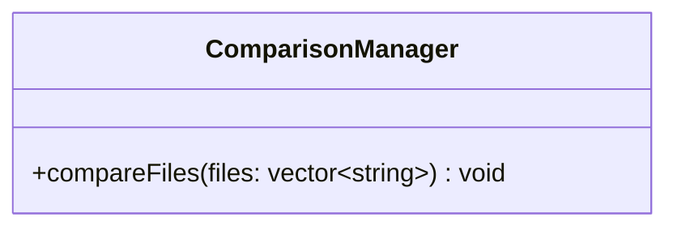

# Class diagram — `ComparisonManager`

**Access:** `compareFiles` is public. **Attributes:** none declared. **Constructors/destructors:** none explicitly declared. The method creates local instances of the other processing/report classes and coordinates pairwise comparison.
