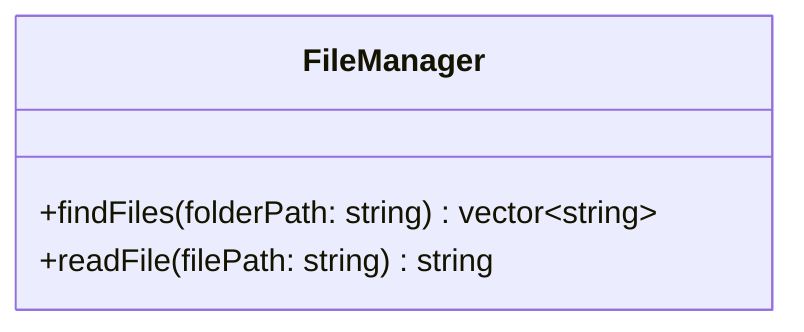

# Class diagram — `FileManager`

**Access:** both methods are public. **Attributes:** none declared. **Constructors/destructors:** none explicitly declared. `findFiles` selects regular files with `.txt`, `.cpp`, `.h`, and `.hpp` extensions; `readFile` returns file content or an empty string if opening fails.
