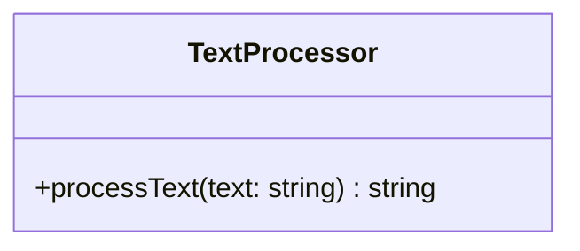

# Class diagram — `TextProcessor`

**Access:** public method. **Attributes:** none declared. **Constructors/destructors:** none explicitly declared. Processing lowercases characters and collapses consecutive whitespace to a single space.
