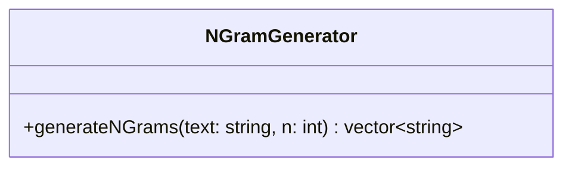

# Class diagram — `NGramGenerator`

**Access:** public method. **Attributes:** none declared. **Constructors/destructors:** none explicitly declared. Splits text on whitespace and creates consecutive word n-grams; returns an empty vector when `n <= 0` or there are fewer than `n` words.
