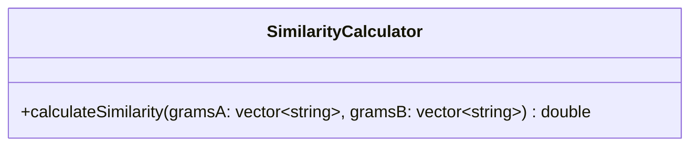

# Class diagram — `SimilarityCalculator`

**Access:** public method. **Attributes:** none declared. **Constructors/destructors:** none explicitly declared. It compares unique n-gram sets and returns the Jaccard intersection-over-union percentage. If both sets are empty, it returns `0.0`.
