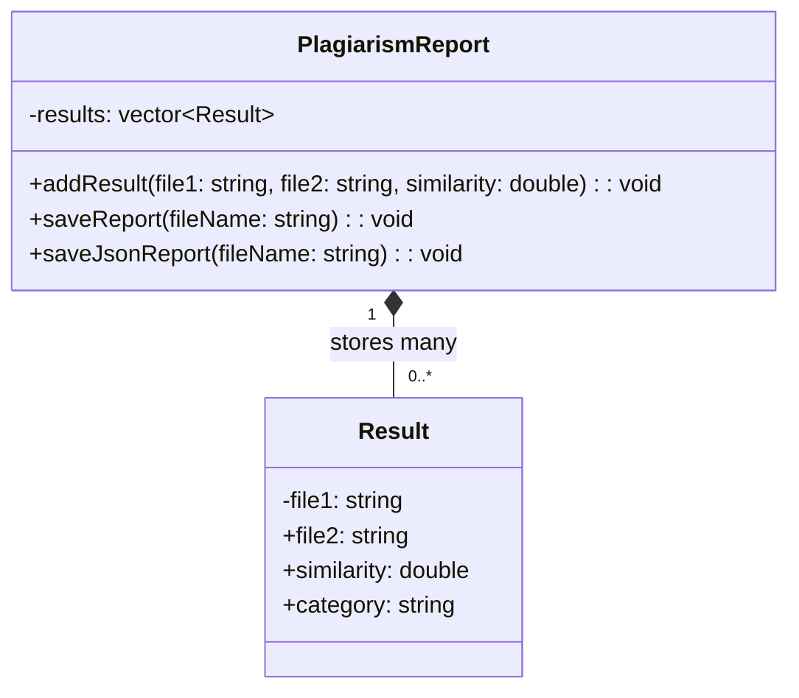

# Class diagram — `PlagiarismReport`

`results` is private. The nested `Result` type is declared in the private section, so its fields are not public API. The diagram shows the fields inside the struct for documentation; they are accessed by the enclosing report implementation. The methods are public. No constructors/destructors are explicitly declared.

**Categories:** `<30` Low; `<60` Moderate; `<80` High; otherwise Very High. Exports are TXT and JSON only.
