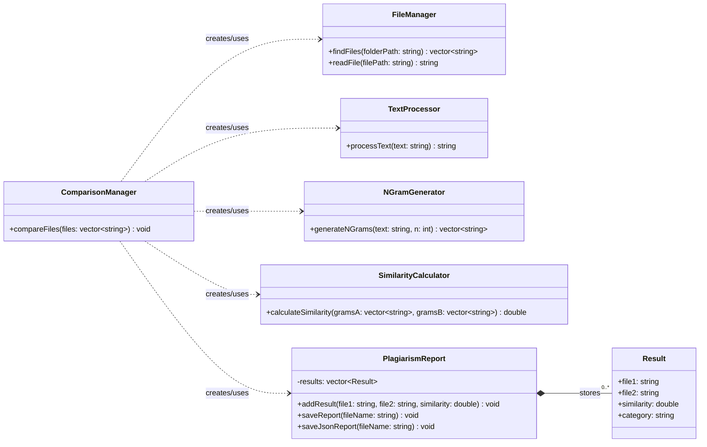

# Complete class relationship diagram

There is no inheritance between the project classes. Dashed arrows are dependencies because `ComparisonManager` constructs local helper objects inside `compareFiles`; these are not long-lived member fields. `PlagiarismReport` stores zero or more nested `Result` records.
