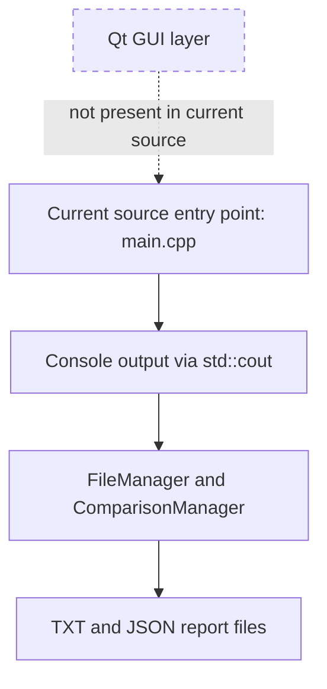

# Architecture — Qt GUI status

**Accuracy note:** No Qt GUI component exists in the supplied `.h`/`.cpp` source: there are no Qt includes, `QApplication`, widgets, signals/slots, or GUI classes. This is a status diagram, not a claim that a Qt interface is implemented. A future GUI could call the existing comparison layer, but that is outside the current code.
