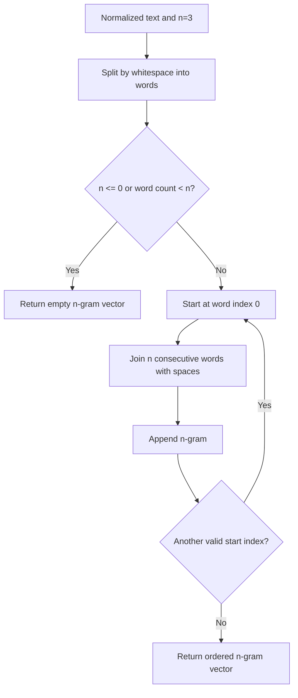

# Architecture — n-gram generation

For words `a b c d` and `n=3`, output is `a b c` and `b c d`. Repeated n-grams may occur in this vector, but the similarity calculator later converts them to sets.
