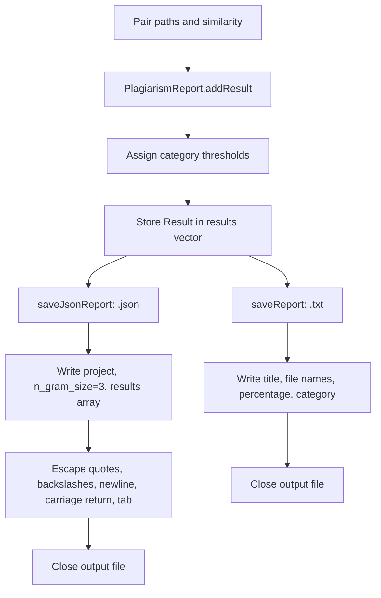

# Architecture — report generation and TXT/JSON export

Categories in the code: below 30 = Low; 30 to below 60 = Moderate; 60 to below 80 = High; 80 or above = Very High. File-open failures while saving cause the save method to return without a message.
