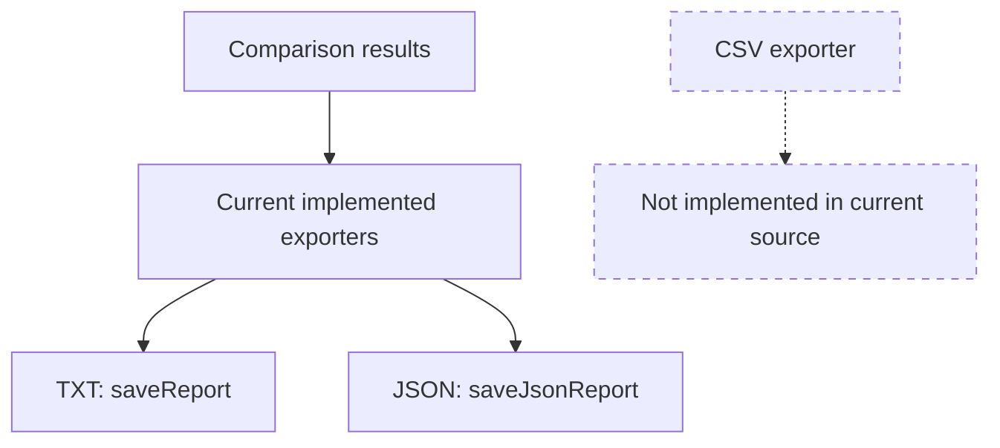

# Architecture — CSV export status

No `saveCsvReport` method, CSV writer, or `.csv` output appears in the inspected source. This diagram records the implementation gap rather than inventing a CSV module.
